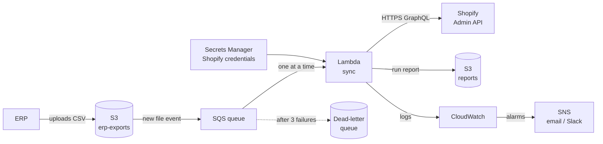

# DESIGN

## 1. Decisions

**1. Set the stock to an exact number, don't add or subtract.**
When the sync updates Shopify, it says *"set AB-100 in Dallas to 8"*, not *"add 3 to AB-100 in Dallas"*.

The difference matters when something runs twice. If "add 3" is sent twice by mistake (a retry, or two runs overlapping), the stock ends up at 11 instead of 8. If "set to 8" is sent twice, the stock is still 8. So running the sync again is always safe: the second run finds nothing to change and reports `UPDATE: 0`.

Two safety checks on top:
- **"Only if it's still 5."** Each update also tells Shopify the value we read before (`changeFromQuantity`). If someone changed the stock in the meantime, Shopify refuses the update (`CHANGE_FROM_QUANTITY_STALE`) instead of overwriting their change.
- **A unique key per request** (idempotency key). If the same request reaches Shopify twice, for example when the client retries after throttling or a temporary Shopify error (HTTP 429/5xx), Shopify applies it only once.

The key is new on every run, so it covers retries **within** a run. Two **separate** runs are covered by the other two pieces: writing exact values (setting 8 twice is still 8) and the "only if it's still 5" check (a run that read an old value is refused).

*Alternative:* Shopify's adjust mutation (`inventoryAdjustQuantities`), which sends +/- changes. It's simpler, but a repeated request would count the change twice, so it isn't safe to retry.

**2. Keep the business rules separate from Shopify and files.**
The sync has two kinds of code:
- **Code that talks to the outside world:** reads the CSV, calls Shopify, writes the report.
- **Code that decides:** applies the 8 business rules (sum the rows, clamp at 0, UPDATE or UNCHANGED…).

I kept them apart. The deciding code lives in two functions, `computeTargets` (rules 1–5) and `decisionStock` (rules 6–8), and they only take data in and give data out. They never open a file or call Shopify.

That makes the most important part easy to test. To check "two rows for the same SKU are summed before clamping", a test just passes in two rows and checks that the result is 6. No CSV file, no Shopify store, no network. The tests run in under a second, so I can run them after every change.

It also makes rule 8 ("never touch inventory that isn't in the ERP export") safe by design: the decisions loop over the **ERP targets**, never over what's in Shopify. Anything that isn't in the export never gets a decision, so it can't be changed.

*Alternative:* one script that reads a row, checks Shopify and writes the update as it goes. It's shorter, but the rules would be mixed with API calls, and testing them would need a real or fake Shopify every time.

**3. Check all incoming data while the program runs, but react differently depending on what's broken.**
TypeScript types only exist while writing code. When the program runs, a CSV cell that says `abc` is just text, and TypeScript can't stop it. So every piece of data that comes from outside (the CSV, the warehouse map, the `.env` settings, Shopify's answers) is checked with Zod while the program runs, before anything uses it.

What happens when something is wrong depends on how bad it is:
- **The warehouse map or the settings are broken:** the run **stops right away** with a clear message. Without them nothing useful can happen, and a half-configured run could do damage.
- **One CSV row is broken:** that row is **rejected and reported** with its line number and reason (`line 11: qty_on_hand must be a whole number`), and the rest of the file is still processed. One bad row should never block thousands of good ones (rule 5).

The checks also clean the data on the way in: SKUs are trimmed and uppercased (` ab-100 ` becomes `AB-100`), and quantities must be whole numbers of 0 or more. An empty cell is rejected instead of silently becoming 0.

*Alternative:* trust TypeScript types only, or check the whole file at once and stop at the first bad row. The first lets bad data through (`abc` would become `NaN`); the second lets one typo block the whole sync.

**4. A small Shopify client of my own that waits the right amount of time when Shopify says "slow down".**
Shopify limits how fast an app can call its API with a **bucket of points**. Every query costs some points, and the bucket refills over time. On my store the bucket holds 2000 points and refills 100 per second. If the bucket runs out, Shopify answers `THROTTLED` instead of the data.

When that happens, the client doesn't fail and doesn't guess how long to wait. Shopify's answer includes the numbers it needs, so it calculates the wait:

> a query needs 152 points, 2 are left, Shopify refills 100 per second → wait (152 − 2) / 100 = **1.5 seconds**, then try again

Other cases:
- **Shopify itself has a temporary problem** (HTTP 429 or 5xx, which come without point numbers): wait 1s, then 2s, 4s, 8s between tries.
- **Any other error** (a wrong query, missing permission): **fail right away**, because trying again wouldn't help.
- **After 5 tries**, it gives up, and the run is reported as failed instead of looping forever.

Each retry sends the exact same request, so for updates it carries the same idempotency key (decision 1), and Shopify won't apply it twice.

The client is about 60 lines on top of Node's built-in `fetch`, and the retry behavior has its own tests: a fake Shopify answers "throttled" or "error", and the tests check the wait and the number of attempts.

*Alternative:* Shopify's official client library (`@shopify/admin-api-client`). It's a good choice for bigger integrations, but I only need three operations, and throttling is a core part of this exercise, so I wanted to own the logic and test it. With more operations, I'd switch to the official client with generated types.

**5. Admin screen: Polaris React + Vite, standalone page.**
A small Express API (`GET /api/report`, `POST /api/sync`) runs the same CLI and serves the last report. Polaris React is deprecated in favor of Polaris web components; I chose it because it is well documented for standalone pages and the brief allows it. Migrating to web components / an embedded app is a next step.

### Assumptions
- **Clamping (confirmed by email with Joaquin, Nov 8):** a row where committed > on-hand is valid (backorder). Rows for the same SKU and warehouse are summed first (on-hand and committed separately), subtracted once, then clamped at 0: `(3 + 10) − (5 + 2) = 6`, not `0 + 8 = 8`.
- A row that is both invalid and in an unmapped warehouse is **rejected**, not ignored (validation runs first).
- A row with an **extra** column is accepted and the extra value is dropped (`relax_column_count`); a row with a **missing** column is rejected.
- SKUs and warehouse codes are compared trimmed and uppercase, on both the ERP and the Shopify side.
- Only the `available` quantity is read and written.
- If two Shopify variants share a SKU, the first one returned is used (not handled specially).
- Untracked inventory items are not handled specially.
- Locations are matched by name (`Atlanta Warehouse`), not by id, so the warehouse map stays readable.

## 2. Production on AWS

The sync runs **whenever the ERP drops a new export**, instead of on a fixed timer, so Shopify is updated as soon as fresh data exists. An alarm covers the case where no export arrives.

- **Trigger:** the ERP uploads the CSV to S3. S3 only shows a file once its upload is complete, so the sync never reads a half-uploaded file.
- **Queue:** S3 sends a "new file" event to an **SQS queue**, and the Lambda takes them **one at a time** (reserved concurrency = 1). Two exports arriving close together never run at the same time. A run that keeps failing is retried, then moved to a **dead-letter queue** for someone to look at.
- **Compute:** a **Lambda** runs the same code as today. Only the inputs and outputs move from local folders to S3. A run takes seconds; if it ever gets close to Lambda's 15-minute limit, the same code moves to an **ECS Fargate** task without changes.
- **Talking to Shopify:** plain HTTPS calls to the GraphQL Admin API, the same as locally. Nothing to install on Shopify's side. The Lambda gets a fresh access token at the start of each run.
- **Secrets:** the Shopify Client ID and secret live in **Secrets Manager**, not in code or environment files.
- **Reports:** written to S3 as the same JSON as today. The admin screen reads the latest one from there.
- **Logs and alerts:** **CloudWatch Logs**, plus alarms sent through **SNS** to email or Slack when:
  - a sync fails
  - **no successful sync in the last 3 hours** (the export stopped arriving)
  - the number of rejected or UNMATCHED rows jumps (bad export)

*Why not a fixed 2-hour schedule?* It would also work (EventBridge Scheduler → Lambda), but it could run on an old file or miss a fresh one. Event-driven plus the "no sync in 3 hours" alarm gives the same guarantee and faster updates.

## 3. Failure modes

**What if Shopify fails halfway through?**

The sync first reads everything and decides what to change. Only then does it write, with all updates sent in one request.
- **Shopify is busy or briefly down:** the client waits and tries again (decision 4). Most hiccups end here, and the run succeeds.
- **It still fails after 5 tries:** the run stops, the report is saved with `status: "failed"` and the error message, and the process exits with code 1, so whatever started it can see it failed.
- **Nothing needs to be undone.** If part of the update did reach Shopify, running the sync again reads the current stock and only updates what's still different. Because the sync sets exact values (decision 1), applying an update that already landed changes nothing.

**What if the CSV arrives half-written?**
- **A cut-off last line** is missing columns, so it's rejected and reported with its line number like any bad row, and the run continues.
- **Rows missing entirely** simply produce no update for those SKUs. The sync never sets stock to 0 just because a SKU isn't in the file (rule 8).
- **Honest gap:** a line cut in the middle of a number (`12` written as `1`) still looks valid, and the code can't tell. The fix would be to have the ERP include the expected row count (or a checksum) with each export and stop the run if it doesn't match.

**What if the job runs twice at the same time?**
- **The admin screen prevents it:** while a sync is running, a second request gets `409 A sync is already running`.
- **If two runs still overlap** (for example, two terminals running `npm run sync`): both read the same stock and compute the same targets. The first one writes. The second one's "only if it's still 5" check (decision 1) no longer matches, so Shopify refuses its update instead of overwriting, and that run is reported as failed.
- **Either way, the final stock is correct,** because both runs would write the same exact values.

## 4. Scale: 50,000 SKUs × 6 locations

That's up to **300,000 rows** in the export. The file itself stays small enough (a few MB) to read and validate all at once, so the CSV part doesn't need to change.

What does need to change is everything that talks to Shopify, plus one lookup:

- **Reading Shopify's stock.** Today, all SKUs go into a single search (`sku:"AB-100" OR sku:"CD-200" OR …`). With 50,000 SKUs that search becomes far too long. The fix is to split the SKUs into batches (say 50 per search). The code already follows Shopify's pages of results, so each batch works as today. For a full catalog, a better option is Shopify's **bulk operations**: you ask once, and Shopify prepares the whole inventory as a file to download, without spending the normal point budget per query.
- **Matching targets to Shopify rows.** `decisionStock` uses `stock.find(...)`, which scans the whole list for every target. That's fine for 7 targets, but with 300,000 of each it means billions of comparisons. The fix is a lookup table keyed by `sku|location`, so each match is instant. This is a small change in one function.
- **Writing updates.** Today, all updates go in one request. Thousands of updates need to be sent in **chunks** (for example, 100 per request). Rule 6 helps a lot here: only values that actually changed are sent, so a normal run between two exports writes far fewer than 300,000 values.
- **Rate limits.** With many more requests, the client would hit Shopify's limit regularly. The retry already handles it correctly. To avoid wasting requests, the client could track the remaining points and wait **before** sending, instead of after a `THROTTLED` answer.
- **Run time.** All of this makes a run take minutes instead of seconds. On AWS that's still fine for Lambda up to its 15-minute limit; beyond that, the same code moves to Fargate (section 2).
- **Much bigger files.** If the export ever grew far beyond this (hundreds of MB), the CSV would need to be read line by line (streaming) instead of all at once. The validation of each row stays exactly the same.

## 5. AI usage log

**Tools:** Claude Code (in the terminal), with Context7 to look up current library docs.

**How I used it:** mostly as a guide. It explained the options and their trade-offs, I decided, and it helped me write and test the code. When something it wrote was too hard to follow, I asked for a simpler version before moving on.

**Most important prompts:**
1. **Typing Shopify's responses.** I asked whether to use a code generator to create TypeScript types for Shopify's GraphQL API (`@shopify/api-codegen-preset`). We compared it with writing Zod schemas by hand. Codegen is the better long-term tool, but it needed setup time I didn't have, so we went with Zod schemas for the responses that matter, and the AI helped me write them.
2. **Choosing the Shopify queries.** I asked it to go through the Shopify GraphQL Admin API docs with me and pick the queries and the mutation the sync needs. It helped me create the files in `src/graphql/`, and we tested each one against my store with real data, printing the input and output of each step so I could see exactly what Shopify sends and receives.
3. **The clamping rule.** The AI said that when committed is greater than on-hand, the result should be clamped to 0. I wasn't sure: a negative result could also mean the row is invalid. We agreed the safest move was to ask, so I emailed ATL Diesel, and they confirmed clamping to 0, summing the rows first.

**Where I rejected or corrected the AI:**
- **Code that was too complex.** Some of the AI's code solved edge cases that didn't exist in the data, and I couldn't explain it line by line. The clearest case was the function that reads Shopify's stock: it used nested Maps, duplicate flags and extra filtering. I asked for a simpler version, and it became a flat list of rows built with two plain loops. For the same reason, I rolled back the AI's first version of the project and rebuilt it step by step.
- **A performance claim I couldn't back up.** The draft of this document included timing and memory numbers from a test the AI had run. I removed them: I hadn't run that test myself, and I don't want to present numbers I can't stand behind.

## 6. Next steps (with another day)

- **Use Shopify's official GraphQL tools.** Replace the hand-written client with `@shopify/admin-api-client` and generate TypeScript types from the queries with Shopify's codegen. Every query and response becomes typed automatically, instead of hand-written Zod schemas and interfaces.
- **Test the whole flow, not only the pieces.** Add an end-to-end test against the dev store: reset the stock → dry run (expect 3 updates) → apply → check Shopify → apply again (expect 0 updates). It automates the check I did by hand.
- **More unit tests where the rules live.** `decisionStock` (UPDATE / UNCHANGED / UNMATCHED) and `loadErpRows` with messy files.
- **Reports in a database instead of files.** Keep every run, so the admin screen can show history and trends, not just the last run.
- **Close the gaps I found:**
  - detect cut-off CSVs with a row count or checksum from the ERP
  - report untracked items and duplicate SKUs as UNMATCHED with a reason
  - reject rows with extra columns
  - retry network errors too
- **A setup script** that creates and deletes the 5 test products, so a new store is ready with one command.
- **Clearer project structure.** Group files by role (business rules, Shopify, inputs/reports), and share the report types between the backend and the admin screen instead of copying them.
