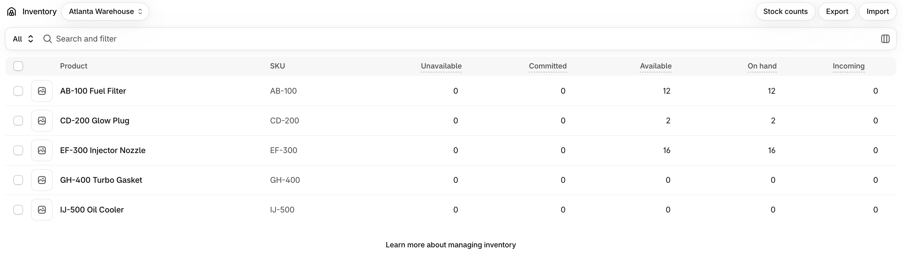
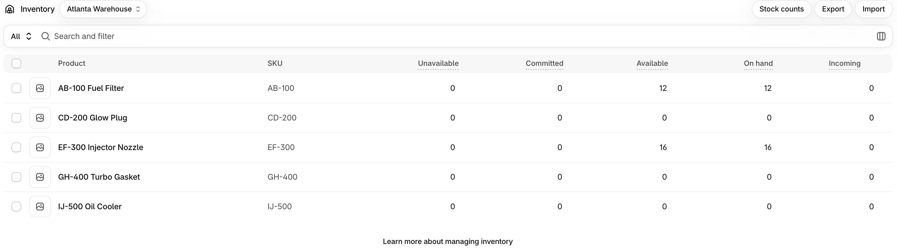
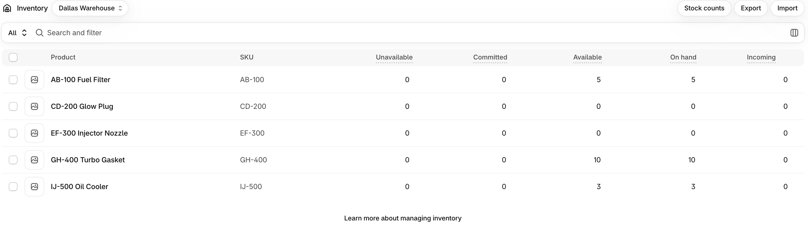
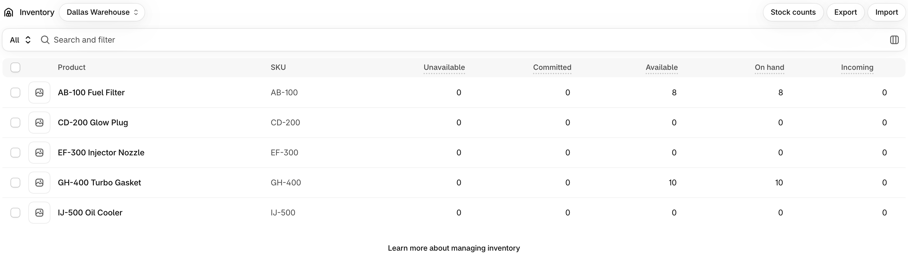
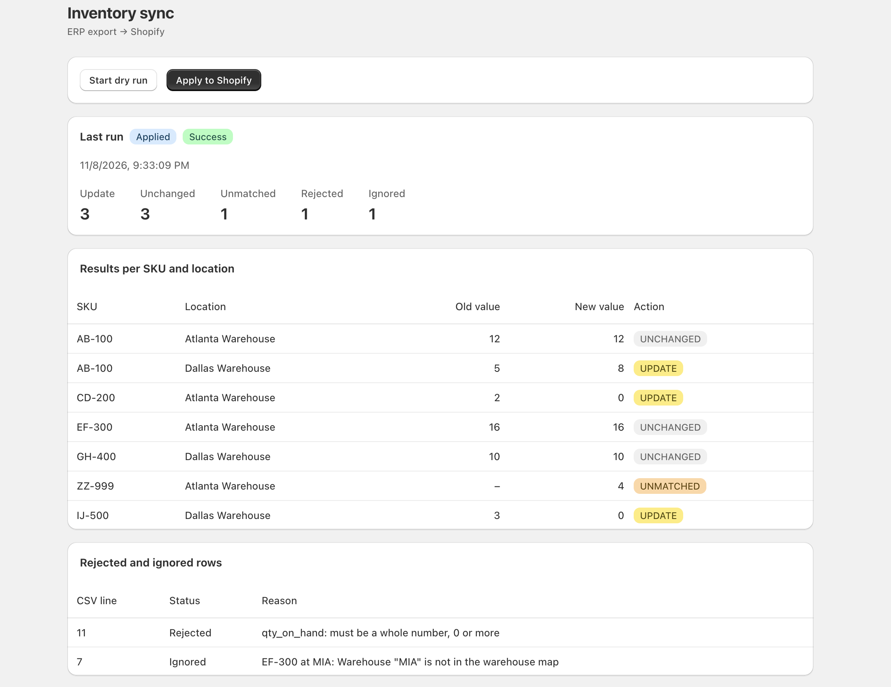

# ATL Diesel – ERP to Shopify Inventory Sync

A Node.js + TypeScript command-line service that reads an ERP inventory export (CSV), computes the available stock per SKU and location, compares it with a Shopify development store through the GraphQL Admin API, and updates only what differs.

```
erp_export.csv + warehouse_map.json
        │  validate (Zod)
        ▼
targets per SKU + location        ── rules 1–5
        │  read current stock (GraphQL)
        ▼
UPDATE / UNCHANGED / UNMATCHED    ── rules 6–8
        │  write absolute quantities (skipped with --dry-run)
        ▼
reports/run-<timestamp>-<mode>.json
```

See [DESIGN.md](DESIGN.md) for decisions, trade-offs and assumptions.

---

## Requirements

- **Node.js 24 or newer** (`node -v`)
- **npm** (comes with Node)
- A free **Shopify Partner account** and a **development store**

---

## 1. Install

```bash
git clone https://github.com/MauricioSauza/atl-diesel-backend.git
cd atl-diesel-backend
npm install
```

---

## 2. Shopify setup (one time, ~30 minutes)

### 2.1 Development store
In the [Shopify Dev Dashboard](https://dev.shopify.com), open **Stores** and create a development store.

> The store must be created from the Dev Dashboard so it belongs to the same organization as the app. Otherwise the token request fails with `shop_not_permitted`.

### 2.2 Locations
In the store admin, go to **Settings → Locations** and create two locations with these **exact** names (they must match `data/warehouse_map.json`):

- `Atlanta Warehouse`
- `Dallas Warehouse`

### 2.3 App and API credentials
1. In the Dev Dashboard, open **Apps → Create app**.
2. App URL: `https://example.com` (placeholder, not used). Uncheck **Embed app in Shopify admin**.
3. Scopes:
   ```
   read_products,read_inventory,write_inventory,read_locations
   ```
4. Create the app (this releases a version with those scopes), then **Install** it on your development store from the app's **Home** page.
5. In the app's **Settings**, copy the **Client ID** and **Client secret**.

The app is only used for API credentials. The sync gets a short-lived access token (24 h) at the start of every run using the [client credentials grant](https://shopify.dev/docs/apps/build/dev-dashboard/get-api-access-tokens).

### 2.4 Products
Create these 5 products in the store admin (**Products → Add product**). For each one: one variant, **SKU** set exactly as below, **Inventory tracked** on.

| SKU    | Atlanta Warehouse | Dallas Warehouse |
|--------|------------------:|-----------------:|
| AB-100 | 12 | 5  |
| CD-200 | 2  | 0  |
| EF-300 | 16 | 0  |
| GH-400 | 0  | 10 |
| IJ-500 | 0  | 3  |

`ZZ-999` and `KL-600` are intentionally **not** created.

After the products exist, the quantities can be (re)set at any time with `npm run reset-stock` (see below).

---

## 3. Environment variables

```bash
cp .env.example .env
```

Fill in `.env`:

| Variable | Example | Description |
|---|---|---|
| `SHOPIFY_SHOP` | `atl-take-home` | Store subdomain, **without** `.myshopify.com` |
| `SHOPIFY_CLIENT_ID` | | From the app's Settings in the Dev Dashboard |
| `SHOPIFY_CLIENT_SECRET` | | From the app's Settings in the Dev Dashboard |
| `SHOPIFY_API_VERSION` | `2026-10` | GraphQL Admin API version (latest stable) |

`.env` is git-ignored. The values are validated at startup; a missing or malformed variable stops the run with a clear message.

---

## 4. Run

### Dry run (reads everything, writes nothing to Shopify)
```bash
npm run sync -- --dry-run
```

### Apply (writes the updates to Shopify)
```bash
npm run sync
```

### Options
| Flag | Default | Description |
|---|---|---|
| `--dry-run` | off | Compute and report everything, but don't write to Shopify |
| `--csv <path>` | `data/erp_export.csv` | ERP export to read |
| `--map <path>` | `data/warehouse_map.json` | Warehouse code → Shopify location name |

Example output:
```
Starting inventory sync (dry run)
  ERP export:    data/erp_export.csv
  Warehouse map: data/warehouse_map.json
  Rows: 9 valid, 1 rejected, 1 ignored
Dry run: nothing written to Shopify
Report: reports/run-2026-11-08T23-27-58.858Z-dry-run.json
```

The process exits with code `1` if the run fails (invalid map, missing config, Shopify error), so a scheduler can detect it.

### Reset the store to the starting stock
```bash
npm run reset-stock
```
Sets the 5 products back to the table in section 2.4. Useful to repeat the dry run → apply → apply-again cycle.

---

## 5. Run report

Every run writes two files to `reports/`:

- `run-<UTC timestamp>-<dry-run|apply>.json`: one file per run (history)
- `latest.json`: a copy of the most recent run

Each report contains:
- `ranAt`, `mode` (`dry-run` or `apply`), `status` (`success` or `failed`), `error`
- `counts` per action: `UPDATE`, `UNCHANGED`, `UNMATCHED`, `rejected`, `ignored`
- `results`: each SKU and location with `oldValue`, `newValue` and `action`
- `rejected`: invalid CSV rows with line number and reason
- `ignored`: rows for warehouses not in the map, with line number and reason

If writing to Shopify fails, the report is still written with `status: "failed"` and the error message.

### Expected result with the sample data
| SKU | Location | Old | New | Action |
|---|---|---:|---:|---|
| AB-100 | Atlanta Warehouse | 12 | 12 | UNCHANGED |
| AB-100 | Dallas Warehouse | 5 | 8 | UPDATE |
| CD-200 | Atlanta Warehouse | 2 | 0 | UPDATE |
| EF-300 | Atlanta Warehouse | 16 | 16 | UNCHANGED |
| GH-400 | Dallas Warehouse | 10 | 10 | UNCHANGED |
| IJ-500 | Dallas Warehouse | 3 | 0 | UPDATE |
| ZZ-999 | Atlanta Warehouse | – | 4 | UNMATCHED |

- Rejected: line 11, `KL-600` (`qty_on_hand` is `abc`)
- Ignored: line 7, `EF-300` at `MIA` (not in the warehouse map)

Running `npm run sync` a second time reports `UPDATE: 0`, because the values now match.

### Shopify inventory before and after the applied run

Only the three `UPDATE` rows changed. Everything else, including stock the ERP export doesn't mention, stayed the same.

**Atlanta Warehouse: before** (CD-200 = 2)



**Atlanta Warehouse: after** (CD-200 = 0)



**Dallas Warehouse: before** (AB-100 = 5, IJ-500 = 3)



**Dallas Warehouse: after** (AB-100 = 8, IJ-500 = 0)



---

## 6. Admin screen

A local page built with Vite, React and [Polaris](https://polaris-react.shopify.com) that shows the last run and starts new runs.

- Last run: when it ran, dry run or applied, success or failed, and counts (UPDATE, UNCHANGED, UNMATCHED, rejected, ignored)
- Table of results per SKU and location (old value, new value, action)
- Rejected and ignored rows with their CSV line and reason
- **Start dry run** and **Apply to Shopify** buttons

It needs two terminals:

```bash
# terminal 1: API (port 3001), runs the sync and serves reports/latest.json
npm run admin:api

# terminal 2: the page (port 5173)
cd admin
npm install
npm run dev
```

Open http://localhost:5173. The page calls `/api/...`, and Vite forwards those requests to the API on port 3001.



| Endpoint | Description |
|---|---|
| `GET /api/report` | Last run report (`404` if there are no runs yet) |
| `POST /api/sync` with `{ "dryRun": true }` or `{ "dryRun": false }` | Runs the sync and returns the new report. `409` if a sync is already running |

---

## 7. Tests and checks

```bash
npm test            # unit tests (reconciliation rules, Shopify client retries, report)
npm run lint        # ESLint (strict, type-checked)
npm run typecheck   # TypeScript, strict
npm run build       # compile to dist/
```

The tests don't call Shopify: the reconciliation tests use plain objects, and the client tests use a fake `fetch` and fake timers.

---

## Project structure

```
data/                          sample ERP export and warehouse map
reports/                       run reports (one per run + latest.json)
src/
  sync.ts                      CLI entry point: runs the whole pipeline
  inputs.ts                    load + validate the CSV and the warehouse map (Zod)
  targets.ts                   business rules 1–5: filter, sum, available stock
  shopify.ts                   config, access token, GraphQL client with throttling retry
  shopify-stock.ts             read current stock per SKU and location
  decision-stock.ts            business rules 6–8: UPDATE / UNCHANGED / UNMATCHED
  apply-updates.ts             write absolute quantities to Shopify
  report.ts                    build and write the run report
  graphql/                     GraphQL queries and mutation
  helpers/sku-search.ts        builds the Shopify SKU search string
  scripts/reset-stock.ts       resets the store to the starting stock
  server.ts                    API for the admin screen (Express)
tests/                         Jest unit tests + test data (constants.ts)
admin/                         admin screen (Vite + React + Polaris)
  src/App.tsx                  page: buttons, last run, tables
  src/api.ts                   calls to the API
  src/types.ts                 run report types
  src/components/              RunSummary, ResultsTable, SkippedRows
```

---

## Business rules

| # | Rule | Where |
|---|---|---|
| 1 | Match SKUs case-insensitively, ignoring leading/trailing spaces | `inputs.ts` (schema), `shopify-stock.ts` |
| 2 | Sum rows with the same SKU and warehouse | `targets.ts` → `sumAvailable` |
| 3 | Available = on-hand − committed, never below 0 (summed first, then clamped) | `targets.ts` → `sumAvailable` |
| 4 | Ignore and report rows for warehouses not in the map | `targets.ts` → `filterRows` |
| 5 | Reject and report invalid quantities; a bad row never stops the run | `inputs.ts` → `loadErpRows` |
| 6 | Only update Shopify when the value differs | `decision-stock.ts` |
| 7 | Report ERP SKUs missing in Shopify as UNMATCHED | `decision-stock.ts` |
| 8 | Never change inventory that isn't in the ERP export | `decision-stock.ts` (loops over ERP targets only) |

---

## Troubleshooting

| Error | Cause |
|---|---|
| `Invalid Shopify config in .env` | A variable is missing or malformed (see section 3) |
| `Shopify token request failed: … shop_not_permitted` | Store and app are in different Dev Dashboard organizations |
| `Shopify token request failed: 401` | Wrong Client ID / secret, or the app isn't installed on the store |
| `access denied` in a GraphQL error | A scope is missing; check section 2.3 and reinstall/approve |
| A SKU shows as `UNMATCHED` unexpectedly | SKU typo in Shopify, or the product has no stock at that location |
| `… not found in Shopify` from `reset-stock` | Product or location name doesn't match section 2.2 / 2.4 |
